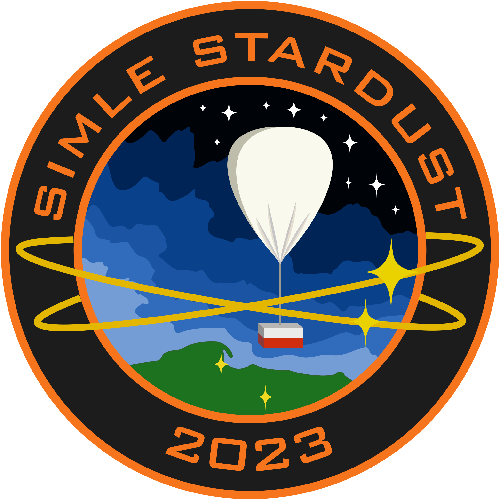

# Wprowadzenie

## Cel dokumentu

Ten dokument opisuje, jak przygotować i wykonać misję balonu stratosferycznego na platformie Stardust NEXT. Platforma to mały balon lateksowy z gondolą styropianową i odcinaczem mechanicznym.

Dokument daje niezbędne minimum, aby nowy zespół wyjął sprzęt z szafki i wykonał misję. Używaj go jako instrukcji dla każdej nowej misji.

Dokument zawiera:

- historię platformy i wnioski z poprzednich lotów,
- wymagania prawne,
- segment naziemny: stanowisko startowe, tankowanie, stacje odbiorcze,
- segment lotny: powłoka, spadochron, olinowanie, odcinacz, gondola,
- oprogramowanie: planowanie lotu, predykcja, śledzenie,
- elektronikę: tracker i komputer pokładowy,
- wykaz materiałów i narzędzi,
- instrukcje montażu,
- listy kontrolne,
- zasady prowadzenia projektu i dokumentacji eksperymentu.

Gdy zmienisz konstrukcję lub procedurę, zaktualizuj odpowiedni rozdział. Gdy misja da nowe wnioski, dopisz je do rozdziału „Historia i wnioski”.

## Szybki start

Gdy przygotowujesz pierwszą misję:

1. Przeczytaj rozdział „Historia i wnioski”.
2. Sprawdź sprzęt z szafki według rozdziału „Wykaz materiałów i narzędzi”.
3. Postępuj według rozdziału „Listy kontrolne”, od pierwszej listy (4 tygodnie przed lotem).

## Platforma Stardust NEXT

Platforma Stardust NEXT to zestaw sprzętu i procedur do lotów balonów stratosferycznych. Koło Naukowe SimLE (Politechnika Gdańska) opracowało platformę na podstawie doświadczeń z projektu Stardust.

Platforma ma trzy zadania:

1. Wynieść ładunek (payload) do stratosfery i bezpiecznie sprowadzić go na ziemię.
2. Oddzielić elektronikę platformy od ładunku. Dzięki temu zespół platformy i zespół ładunku pracują niezależnie.
3. Używać powtarzalnych komponentów i procedur, aby każdy nowy zespół mógł wykonać misję.

## Typowy lot

Typowy lot balonu lateksowego trwa około 2–3 godzin:

1. Wznoszenie z prędkością około 5 m/s.
2. Pęknięcie powłoki na wysokości około 30–35 km (albo odcięcie ładunku przez odcinacz).
3. Opadanie na spadochronie.
4. Lądowanie w odległości od kilkunastu do ponad 200 km od miejsca startu. Odległość zależy od wiatru.

Stratosfera to warstwa atmosfery od około 15 do 50 km. Warunki w stratosferze:

- temperatura powietrza do około −60 °C,
- ciśnienie poniżej 100 hPa (na 33 km około 7 hPa),
- silne promieniowanie UV i kosmiczne.

Projektuj sprzęt na te warunki (rozdziały „Segment lotny” i „Elektronika”).

## Architektura misji

Misja ma dwa segmenty.

**Segment naziemny:**

- stanowisko startowe i zestaw do tankowania,
- stacja odbiorcza stacjonarna,
- stacja odbiorcza mobilna w samochodzie pościgowym,
- oprogramowanie do planowania, predykcji i śledzenia lotu.

**Segment lotny (zestaw lotny, od góry):**

1. Powłoka balonu wypełniona gazem nośnym.
2. Krętlik (swivel).
3. Spadochron.
4. Olinowanie (rig) z odcinaczem.
5. Platforma: gondola z elektroniką platformy (tracker, komputer pokładowy).
6. Ładunki (payloads).

## Fazy misji

| Faza | Zadania | Rozdział |
|------------------------|------------------------------------------------------------|----------------------------------------|
| Planowanie | Cel misji, bilans masy, ilość gazu, predykcja trajektorii, wybór terminu. | Oprogramowanie |
| Formalności | Klasa balonu, zgłoszenie lotu, ubezpieczenie, licencja radiowa. | Wymagania prawne |
| Budowa i testy | Montaż gondoli, olinowania, odcinacza, testy elektroniki. | Segment lotny, Elektronika, Montaż |
| Przygotowanie stanowiska | Rozłożenie podłoża, przygotowanie sprzętu, test trackera. | Segment naziemny |
| Tankowanie i start | Napełnienie powłoki, montaż zestawu lotnego, start. | Segment naziemny, Listy kontrolne |
| Lot i pościg | Odbiór pozycji, jazda w kierunku predykcji lądowania. | Oprogramowanie, Listy kontrolne |
| Odzyskanie | Lokalizacja ładunku, zabezpieczenie danych, zgłoszenie końca lotu. | Listy kontrolne |
| Analiza | Raport z misji, wnioski, aktualizacja dokumentacji. | Prowadzenie projektu, Historia i wnioski |

{ width=35% }
