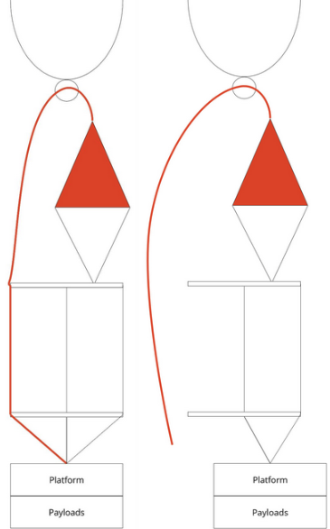

# Historia i wnioski

Ten rozdział opisuje, skąd wzięła się platforma Stardust NEXT i jakie wnioski z poprzednich lotów kształtują procedury w tym dokumencie. Po każdej misji dopisz wiersz do tabeli i nowe wnioski.

## Skąd pochodzi platforma

Zespół Stardust (Koło Naukowe SimLE, Politechnika Gdańska) wypuszcza balony stratosferyczne od 2016 roku. Pierwsze misje własne (2016–2020) służyły badaniom mikroorganizmów w stratosferze. W 2021 roku eksperyment Stardust poleciał na balonie BEXUS 30 (program REXUS/BEXUS). Po tym programie starsi członkowie skończyli studia. Nowy zespół, Stardust NEXT, zbudował małą platformę balonową, którą może powtórzyć każdy nowy skład zespołu.

Praktyki projektowe z programu REXUS/BEXUS opisuje rozdział „Prowadzenie projektu i dokumentacja”.

## Misje własne

| Data | Start | Ładunek | Pułap | Wynik |
|----------|------|--------------------------------------------------------|-----------------|------------------------------------------------------------|
| 2016 | Polska | Gondola z mikrokontrolerem, prosty odcinacz | — | Pierwszy lot. Zespół nauczył się startu. |
| 09.2017 | Toruń | Układ próbkujący (6 filtrów) | ok. 30 km | Zawory nie otworzyły się. Lądowanie na drzewie. |
| 05.2018 | Polska | Układ próbkujący (2 filtry) + ładunek gościnny | dolna stratosfera | Sukces. |
| 20.07.2020 | Toruń | Test układu dla BEXUS, ok. 4 kg, 2 gondole | 33,3 km | Brak odcinacza. Balon dryfował 2 h. Lądowanie 200 km od startu. |
| 27.02.2022 | Iława | Radiosonda z kamerą (lot szkoleniowy) | 33,4 km | Sukces. Lądowanie w okolicy Brodnicy. |
| 26.05.2023 | Iława | Platforma NEXT: OBC, łączność, odcinacz serwomechaniczny | 34 km | Odcinacz nie zadziałał. Lądowanie 23 km od startu. |
| 09.08.2023 | Polska | Platforma NEXT + ładunek STORM (pobór powietrza) | — | Odcinacz z drutem oporowym nie zadziałał. Ładunek zebrał dane. |

## Stardust NEXT

### Lot szkoleniowy (luty 2022)

Cel: nauczyć nowy zespół procedur. Ładunek: radiosonda z kamerą, telemetria RTTY i APRS.

Zespół ćwiczył trzy fazy:

1. Przygotowanie sprzętu i stanowiska startowego.
2. Tankowanie i start.
3. Śledzenie, pościg samochodem, odzyskanie.

Ten format to wzór dla każdej nowej grupy rekrutów: pierwsza misja ma prosty ładunek i skupia się na procedurach.

### Test platformy (maj 2023)

Pierwsza misja, którą nowy zespół zaprojektował i zbudował samodzielnie. Testowane systemy: komputer pokładowy (OBC), łączność i namierzanie, nowe olinowanie z odcinaczem mechanicznym, gondola z pudełek styropianowych. Lot: 34 km po około 90 minutach.

Odcinacz mechaniczny przeniesiono z góry spadochronu na dół, do gondoli. Powód: zespół nie miał doświadczenia z odcinaczem sterowanym zdalnie. Serwo w gondoli miało zwolnić linkę, która trzyma balon.

Problem: odcinacz nie zadziałał. Gondola obracała się w locie. Krętlik był tylko na górze olinowania (między balonem a linkami). Na dole nie było krętlika i linki splątały się. Linka odcinacza nie mogła się zwolnić.

Zabezpieczenie, które zadziałało: dodatkowe 10–15 m linki (czerwona linia na rysunku). Spadochron miał miejsce na otwarcie mimo skręconych linek. Zestaw wylądował bezpiecznie.

{ width=40% }

### Ładunek STORM (sierpień 2023)

Pierwsza misja nowego zespołu bez pomocy starszych członków. Zespół zmniejszył masę komponentów i zastąpił odcinacz serwomechaniczny odcinaczem z drutem oporowym. Olinowanie bez zmian.

Problem: drut oporowy grzał się za krótko i nie przeciął linki.

## Wnioski

Stosuj te wnioski w każdej misji.

| Obszar | Wniosek | Źródło |
|-------------------|------------------------------------------------------------|------|
| Odcinacz | Każdy lot musi mieć odcinacz. Bez odcinacza balon może dryfować godzinami i wylądować daleko. | 2020 |
| Odcinacz | Testuj odcinacz w warunkach lotu: zimno, obrót gondoli, skręcone linki, pełne obciążenie. | 2023 |
| Olinowanie | Gondola obraca się w locie. Daj krętlik pod balonem i zapas linki (10–15 m) pod spadochronem. | 2023 |
| Gaz | Butla może mieć mniej gazu, niż deklaruje dostawca. Zamów gaz z zapasem. Mierz siłę nośną obciążnikiem. | 2020 |
| Wysokość | Wzór na wysokość z ciśnienia działa tylko do około 10 km. Powyżej używaj GPS. | 2020 |
| Czujniki | Czujnik BME280 nie mierzy poniżej 300 hPa. Odrzucaj kody błędów czujników w programie. | 2020 |
| Anteny | Źle zmontowana antena wyłączyła APRS. Sprawdzaj odbiór telemetrii na stanowisku przed startem. | 2020 |
| Śledzenie | Używaj co najmniej dwóch niezależnych systemów śledzenia. Dodaj lokalizator po lądowaniu. | 2020 |
| Łączność wewnętrzna | Nie używaj WiFi między gondolami. Używaj kabla albo osobnego GPS w każdej gondoli. | 2020 |
| Zasilanie | Każde urządzenie (także kamera) musi działać przez cały lot z zapasem. Kamera bez zewnętrznej baterii wyłączyła się po 30 minutach. | 2020 |
| Termika | Elektronika w izolowanej gondoli może się przegrzać latem (ponad 50 °C). Nie dodawaj izolacji ani grzałek bez obliczeń. | 2020 |
| Mechanika | Mocuj elektronikę tak, aby przetrwała lądowanie. Dystanse PCB pękły przy uderzeniu. | 2020 |
| Montaż | Każdy podzespół ma osobę odpowiedzialną albo opisaną procedurę montażu. | 2020 |
| Diagnostyka | Dodaj diody statusu, aby szybko sprawdzić stan systemu na stanowisku. | 2020 |
| Planowanie | Wiatr decyduje o trasie lotu. Planuj start z predykcją trajektorii. | 2016 |
| Zespół | Pierwsza misja nowego zespołu to lot szkoleniowy z prostym ładunkiem. | 2022 |

## Źródła

- M. Jasiukowicz i in., *Life after BEXUS: Stratospheric balloon activities at Gdańsk University of Technology*, ESA PAC Symposium 2024 (kopia w katalogu `papers/`). <https://yasiu.pl/blog/life-after-bexus-pac-2024-in-lucerne/>
- M. Jasiukowicz i in., *SimLE Stardust: How an experiment evolved from student tinkering to a stratospheric research platform*, IAC 2023, IAC-23,A1,6,4,x80448. <https://yasiu.pl/blog/seven-years-of-stardust-iac-2023-in-baku/>
- *Stardust Test Mission Technical Report 2020/07/20*. <https://yasiu.pl/blog/stardust-stratospheric-balloon-mission/>
- M. Jasiukowicz, *Stardust – Stratosferyczna platforma eksperymentalna*, praca inżynierska, Politechnika Gdańska, 2022. <https://yasiu.pl/blog/engineering-thesis-stardust/>
- Lot szkoleniowy 2022 (wideo, ślady KML): <https://yasiu.pl/blog/simle-stardust-mission/>
- Test platformy 2023: <https://yasiu.pl/blog/stardust-balloon-mission-from-ilawa/>
