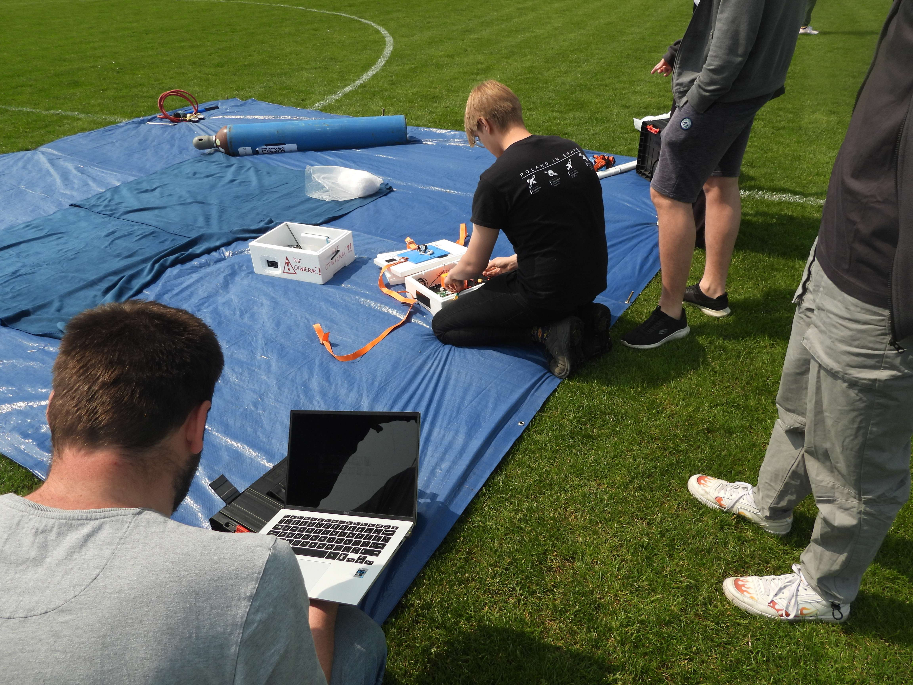
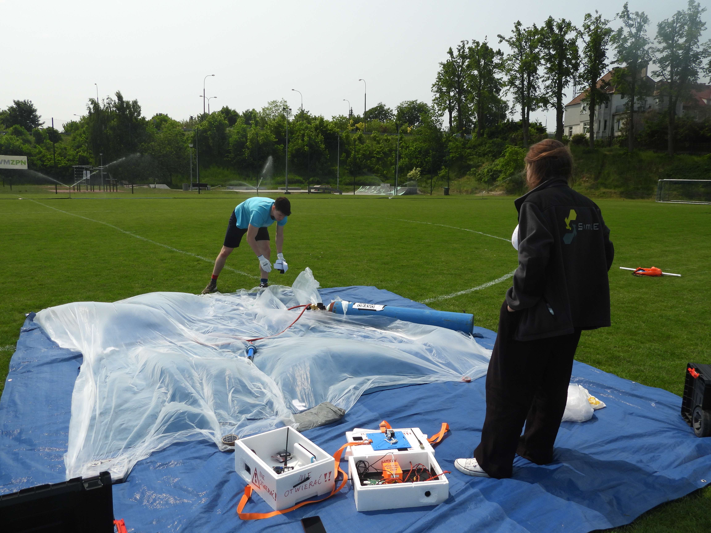
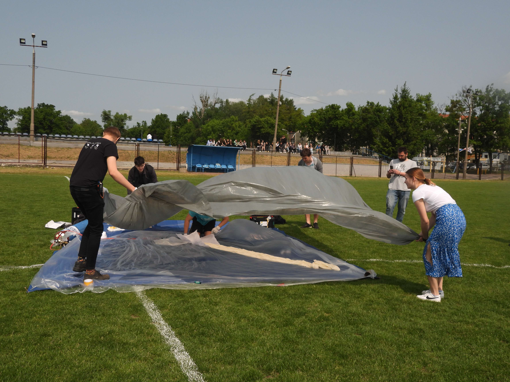

# Segment naziemny

## Stanowisko startowe

Wybierz otwarty teren bez drzew i linii energetycznych, np. boisko. Powłoka balonu jest delikatna. Gałązki, korzenie i kamienie mogą ją przebić.

**Warstwy podłoża (od dołu):**

1. Plandeka – chroni przed wilgocią z ziemi. Jest ważna przy starcie rano.
2. Koc – chroni powłokę przed przebiciem przez korzenie i odrosty. Gruby koc działa lepiej niż cienki.
3. Folia malarska cienka – pod powłoką.
4. Powłoka balonu i zestaw do tankowania.
5. Folia malarska grubsza – na powłoce. Przytrzymuje powłokę, aby nie odleciała w trakcie tankowania.

Cienka folia na wierzchu może się porwać. Wtedy balon może odlecieć w trakcie tankowania. Grubsza folia jest pewniejsza. Kup oba rodzaje, aby mieć wybór.

Wszystkie materiały na podłoże kupisz w markecie budowlanym (np. Castorama). Kup je na jeden paragon, razem z zamówieniem gazu – upraszcza to rozliczenie.

{ width=80% }

{ width=80% }

{ width=80% }

## Tankowanie

### Sprzęt

- butla z helem i reduktor,
- wąż i końcówka do napełniania,
- obciążnik (np. butelka z wodą) i waga,
- rękawiczki (tłuszcz ze skóry osłabia lateks),
- opaski zaciskowe i taśma do zamknięcia szyjki,
- klucz do reduktora (francuski lub calowy – zależnie od butli).

### Metoda z obciążnikiem

1. Odczytaj z kalkulatora siłę nośną szyjki (neck lift).
2. Przygotuj obciążnik o masie równej tej sile nośnej. Uwzględnij masę końcówki do napełniania, jeśli wisi razem z obciążnikiem. Zważ obciążnik.
3. Przywiąż obciążnik do szyjki balonu.
4. Napełniaj powłokę przez końcówkę (najlepiej z zaworem zwrotnym).
5. Zatrzymaj tankowanie, gdy balon unosi obciążnik (balon jest w równowadze lub lekko się wznosi).
6. Zamknij szyjkę: zegnij ją, zaciśnij opaskami i owiń taśmą.
7. Przywiąż olinowanie do szyjki.

{ width=80% }

### Metoda bez obciążnika

Bez zaworu zwrotnego i obciążnika możesz obliczyć objętość helu z różnicy ciśnień w butli albo z różnicy masy butli. Obie metody są mniej dokładne. Ważenie butli jest trudne. Używaj metody z obciążnikiem.

{ width=80% }

## Stacje odbiorcze

Użyj co najmniej dwóch stacji odbiorczych: stacjonarnej i mobilnej. Nie polegaj tylko na sieci innych nasłuchowców.

### Stacja stacjonarna

- Antena kierunkowa lub dookólna na wysokim maszcie, odbiornik i komputer podłączony do internetu.
- Stacja wysyła odebrane pakiety do SondeHub i APRS-IS.
- Przykład: stacja sieci SatNOGS z anteną Cross Yagi VHF/UHF (<https://network.satnogs.org/stations/3702/>).

### Stacja mobilna

Wariant 1 – radiotelefon:

- radiotelefon z dekoderem APRS (np. Yaesu FT5DE),
- antena samochodowa VHF/UHF na magnesie (np. Nagoya UT-72).

Wariant 2 – odbiornik SDR:

- odbiornik RTL-SDR,
- przedwzmacniacz niskoszumny (LNA),
- filtry pasmowe,
- laptop z oprogramowaniem dekodującym (APRS lub RTTY/LoRa – zależnie od trackera).

