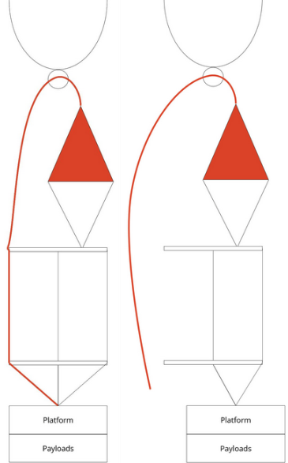
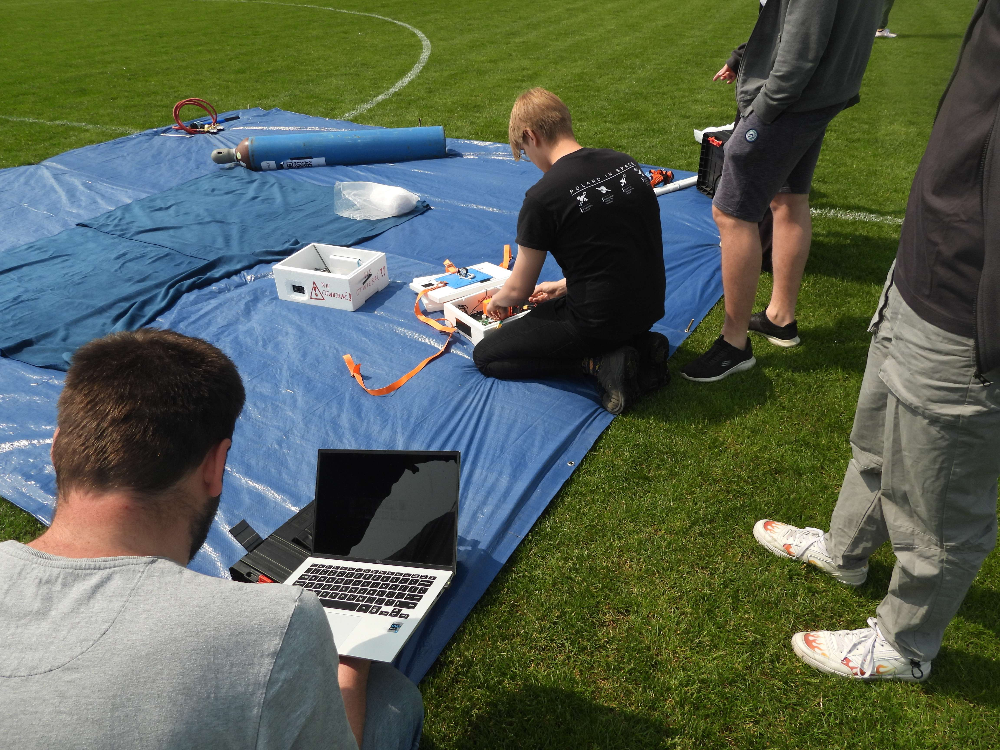

# Segment lotny

Zestaw lotny (flight train) to wszystko, co leci. Elementy od góry:

1. Powłoka balonu z gazem nośnym.
2. Krętlik (swivel).
3. Spadochron.
4. Olinowanie z odcinaczem.
5. Gondola platformy.
6. Gondole ładunków.

{ width=40% }

## Budżet masy

Projektuj zestaw jako balon **lekki** (rozdział „Wymagania prawne”):

- łączna masa ładunku poniżej 4 kg,
- masa każdego pakietu poniżej 2 kg,
- linka podwieszenia zrywa się przy sile poniżej 230 N.

Prowadź tabelę mas. Zważ każdy element przed misją.

| Element | Masa [g] |
|---------------------------------------------|--------|
| Spadochron | |
| Olinowanie, krętlik, odcinacz | |
| Gondola platformy (z elektroniką i bateriami) | |
| Gondole ładunków | |
| **Razem (masa ładunku do kalkulatora)** | |
| Powłoka (osobno, z karty katalogowej) | |

## Powłoka

- Typ: lateksowa powłoka meteorologiczna (np. Hwoyee, Kaymont, Pawan).
- Dostawca w Polsce: <https://nearspace.pl/> (powłoki, spadochrony, akcesoria do napełniania).
- Wybierz rozmiar powłoki w kalkulatorze SondeHub (rozdział „Oprogramowanie”). Większa powłoka pęka wyżej, ale potrzebuje więcej gazu.
- Gaz nośny: hel (bezpieczny) albo wodór (palny – wymaga dodatkowych środków bezpieczeństwa).

**Obsługa powłoki:**

- Przechowuj powłokę w oryginalnym opakowaniu, w ciemnym i chłodnym miejscu.
- Dotykaj powłoki tylko w czystych rękawiczkach. Tłuszcz ze skóry osłabia lateks.
- Nie kładź powłoki na gołej ziemi (rozdział „Segment naziemny”).

## Spadochron

- Dobierz spadochron do masy ładunku. Docelowa prędkość lądowania to około 5 m/s.
- Spadochron wisi pod krętlikiem, nad olinowaniem gondoli. Spadochron jest stale otwarty (nie ma mechanizmu wyrzutu).
- Kolor i średnicę spadochronu wpisz do zgłoszenia PAŻP.

## Olinowanie

Materiały:

- taśma (pasek) parciana,
- plastikowe regulatory do taśmy (np. <https://ustefana.pl/regulatory-plastikowe/2-52937>),
- linka o średnicy około 1 mm i wytrzymałości poniżej 230 N,
- krętlik.

Zasady:

1. Krętlik montuj bezpośrednio pod powłoką. Krętlik zmniejsza skręcanie linek, gdy gondola się obraca.
2. Dodaj 10–15 m zapasu linki między odcinaczem a spadochronem. Zapas daje spadochronowi miejsce na otwarcie, gdy linki się skręcą.
3. Gondole łącz taśmą z regulatorami. Regulatory pozwalają szybko wyrównać długości na stanowisku.
4. Zabezpiecz każdy węzeł taśmą klejącą.

## Odcinacz mechaniczny

Odcinacz kończy lot na komendę albo automatycznie. Odcinacz oddziela zestaw (spadochron + gondole) od powłoki.

### Zasada działania

Odcinacz jest w gondoli platformy, nie pod balonem. Linka odcinacza biegnie z góry zestawu (od powłoki) w dół do gondoli i jest zaczepiona o zwalniacz serwomechaniczny. Gdy serwo zwalnia linkę, zestaw odłącza się od powłoki i opada na spadochronie.

Zalety: cała elektronika jest w jednej gondoli. Odcinacz nie wymaga zasilania pod balonem.

Wada: obrót gondoli skręca linki. Skręcone linki mogą zablokować linkę odcinacza (misja z maja 2023).

### Elementy

- Zwalniacz ładunku sterowany serwem (PWM, zasilanie 5–7,2 V, masa około 76 g), np. typu „paraboliczny zwalniacz zrzutu ładunku” do dronów.
- Sterowanie serwem z komputera pokładowego.

### Wymagania

- Odcinacz musi działać na komendę z ziemi albo automatycznie (np. po czasie lub po przekroczeniu wysokości).
- Ustaw automatyczne odcięcie, gdy balon nie pęknie (np. lot poziomy dłuższy niż zadany czas).
- Sprawdź odcinacz w temperaturze około −40 °C.
- Sprawdź odcinacz pod pełnym obciążeniem i ze skręconymi linkami.
- Sprawdź zwolnienie linki na stanowisku przed startem (bez obciążenia), potem zabezpiecz linkę.

### Znane problemy

| Problem | Przyczyna | Środek zaradczy |
|--------------------------------|--------------------------------------------------|------------------------------------------------------------|
| Linka odcinacza nie zwolniła się | Skręcone linki pod gondolą (brak krętlika na dole) | Zapas linki 10–15 m. Rozważ drugi krętlik nad gondolą. Prowadź linkę odcinacza tak, aby skręt jej nie blokował. |
| Drut oporowy nie przeciął linki | Za krótki czas grzania | Testuj czas grzania w niskiej temperaturze i ciśnieniu. Zwiększ czas i sprawdź pojemność baterii. |

## Gondola

Gondola to pudełko styropianowe typu „styrobox” (np. STX3-7, 5 l). Pudełka są tanie, lekkie, izolują ciepło i chronią sprzęt przy lądowaniu.

Zasady:

- Gondola platformy zawiera tylko elektronikę platformy: tracker, komputer pokładowy, odcinacz, baterie.
- Każdy ładunek ma własne pudełko. Pudełka łączą się z olinowaniem w ten sam sposób (standardowy interfejs mechaniczny).
- Antenę nadajnika montuj pod gondolą, skierowaną w dół.
- Antenę GPS montuj na górze gondoli, z widokiem na niebo, z dala od metalu (baterie, kamery).
- Mocuj elektronikę tak, aby przetrwała uderzenie przy lądowaniu.
- Zamknij pudełko taśmą klejącą dookoła.
- Naklej tabliczkę z danymi kontaktowymi (rozdział „Wymagania prawne”).

{ width=70% }

## Kontrakt z ładunkiem

Każdy ładunek dostarcza zespołowi platformy przed misją:

- masę i wymiary,
- sposób zasilania (własne baterie – platforma nie zasila ładunków),
- emitowane częstotliwości radiowe (kontrola zakłóceń z trackerem),
- wymagania (wysokość, temperatura, orientacja),
- procedurę włączenia przed startem.
